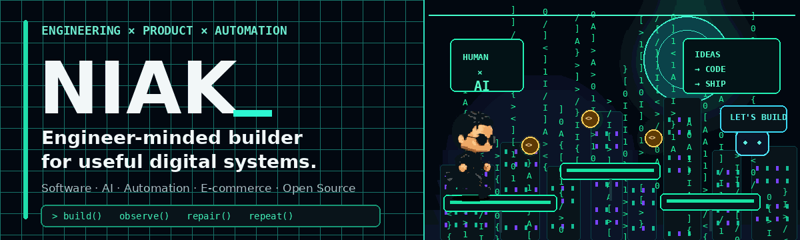
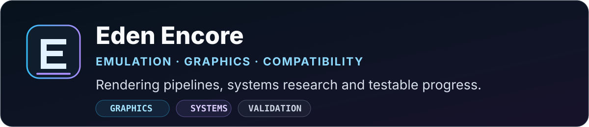
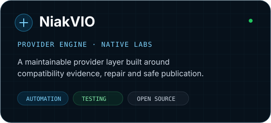
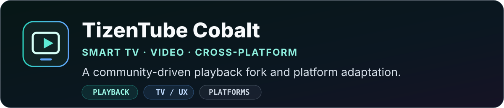
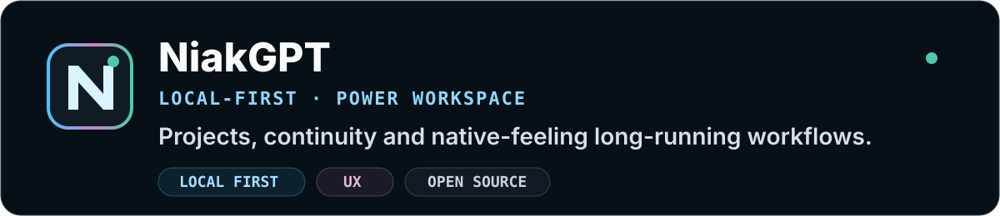
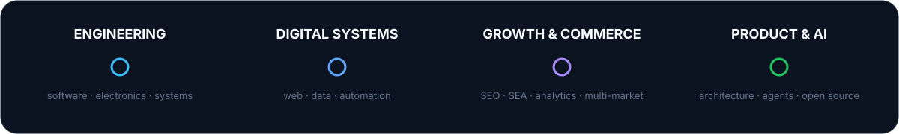
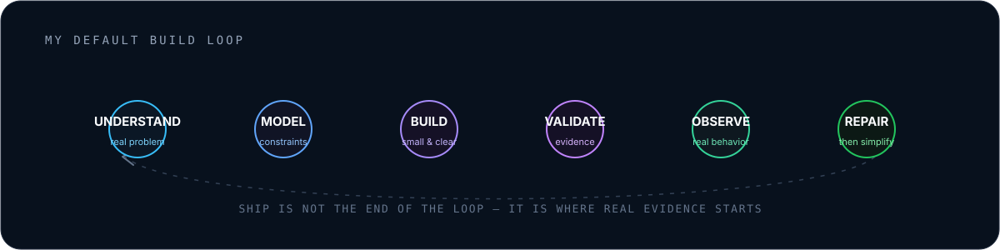

  

    

  

  <h2>Salut, moi c'est Niak.</h2>
  <strong>Ingénierie logicielle · Produit &amp; croissance digitale · IA &amp; automatisation</strong>
  
Je conçois des logiciels utiles et maintenables, au croisement des systèmes et des contraintes du terrain.

  <strong>Français</strong> · <a href="README.md">English</a>
    

  <a href="#projets-en-vedette">Projets</a> ·
  <a href="#parcours">Parcours</a> ·
  <a href="#ma-manière-de-construire">Méthode</a> ·
  <a href="#toolbox">Compétences</a> ·
  <a href="#activité-github">Activité</a>

<!-- Le visuel PRO ci-dessus est un badge README personnalisé, distinct du badge natif de l'abonnement GitHub. -->

 

## Ce que je construis

Je travaille à la croisée de **l'ingénierie logicielle, des produits numériques et de l'automatisation**. Mon parcours relie le développement applicatif à plus de dix ans d'expérience dans le web, l'e-commerce et la croissance digitale : opérations multi-marchés, marketplaces, analytics et conversion.

Aujourd'hui, je me concentre sur **l'ingénierie assistée par IA, la fiabilité des systèmes, la compatibilité et l'automatisation utile**. Je privilégie les avancées vérifiables, les tests représentatifs et les architectures maintenables aux démonstrations flatteuses.

## Projets en vedette

**[Eden Encore](https://github.com/niakw/ProsperoEden-Encore)** — travaux d'ingénierie et de recherche sur l'émulation et la compatibilité, avec un accent sur les pipelines graphiques, l'intégration système, les validations hôte et les résultats reproductibles. **Développement actif ; compatibilité encore en chantier.**

**[NiakVIO](https://github.com/niakw/NiakVIO)** — une plateforme de providers axée sur la compatibilité prouvée, le diagnostic structuré, les workflows de réparation et les vérifications sur appareils natifs. [Présentation du projet](https://projects.eittyweb.fr/en/niakvio/).

**[TizenTube Cobalt](https://github.com/niakw/TizenTubeCobalt)** — fork communautaire autour de la lecture vidéo, de la stabilité sur TV connectées, de l'expérience de visionnage et des adaptations multi-plateformes. **En développement actif.**

**[NiakGPT](https://github.com/niakw/NiakGPT)** — un environnement local-first explorant la continuité, la navigation et l'ergonomie des projets ChatGPT complexes et de longue durée. [Présentation du projet](https://projects.eittyweb.fr/en/niakgpt/).

 

## Parcours

- **Ingénierie** — applications métiers, plateformes web, intégration de systèmes, bases de données et automatisation.
- **Produit & croissance** — pilotage du marketing digital et de l'e-commerce sur **plus de 20 propriétés web dans quatre marchés européens**.
- **Réalisation** — relier architecture et développement aux usages, à la performance, à la maintenance et aux résultats mesurables.

  

 

## Ma manière de construire

Trois règles restent visibles dans presque tout ce que je construis :

- **Comprendre le vrai problème avant de l'automatiser.**
- **Préférer la preuve aux suppositions.**
- **Concevoir pour l'échec, l'observation et la réparation.**

<strong>Les principes derrière cette méthode</strong>

 

- Rendre compréhensible ce qui est complexe.
- Automatiser la répétition — pas la responsabilité.
- Garder les échecs visibles plutôt que fabriquer des checks verts.
- Utiliser l'IA pour étendre le jugement, pas pour le masquer.
- Faire de l'architecture un support à l'itération plutôt qu'un exercice de style.
- Livrer → observer → réparer → simplifier → recommencer.

 

  

 

## Toolbox

**Langages & socle engineering**  
`JavaScript` · `TypeScript` · `PHP` · `Python` · `C++` · `C` · `SQL` · `HTML` · `CSS`

**Stack applicative principale**  
`Node.js` · `React` · `Next.js` · `Symfony` · `REST APIs` · `Extensions navigateur`

<strong>Toolbox & domaines complets</strong>

 

- **Programmation & ingénierie logicielle** — JavaScript, TypeScript, PHP, Python, C++, C, SQL, HTML, CSS, programmation orientée objet, architecture applicative, applications métiers et résolution de problèmes techniques.
- **Web & stack applicative** — Node.js, React, Next.js, Symfony, APIs REST, JSON, extensions navigateur, WebViews, intégrations tierces et architecture d'applications web.
- **Data & bases de données** — PostgreSQL, MySQL, SQLite, modélisation relationnelle, ETL, Talend, transformation de données et workflows applicatifs basés sur les données.
- **Systèmes & infrastructure** — Linux/VPS, Docker, Docker Compose, Git, GitHub Actions, CI/CD, Cloudflare, Nginx/Caddy, systemd, reverse proxy/HTTPS, workflows de déploiement, health checks, logs, monitoring, sauvegardes et logique de rollback.
- **Tests & tooling plateformes** — scripts Python de test/validation, CodeQL, Dependabot, Playwright/Chromium, émulateur Android/ADB, tests natifs Android/TV, CI basée sur QEMU et travail de compatibilité multi-device.
- **IA & automatisation** — workflows assistés par IA, orchestration d'agents, routage multi-provider, boucles de validation, outils local-first, automatisation API, Zapier, design de workflows et automatisation de processus.
- **Plateformes e-commerce** — PrestaShop, Shopify, WordPress, Webflow, gestion de catalogues, données produits, marketplaces, modules/connecteurs, environnements multi-boutiques et architecture e-commerce.
- **SEO & acquisition** — SEO technique, stratégie contenu/recherche, SEA, Google Ads, Meta Ads, TikTok Ads, acquisition marketplaces et croissance multi-marchés.
- **Analytics & performance** — Google Analytics, plans de tracking, instrumentation analytics, Looker Studio, dashboards KPI, Excel, analyse de conversion, UX/CRO et reporting de performance.
- **CRM & lifecycle** — emailing, Mailchimp, Brevo/Sendinblue, Mailjet, scénarios d'automatisation et optimisation du parcours client.
- **Produit & delivery** — architecture produit, stratégie digitale, pilotage de projet, cadrage, coordination prestataires, delivery transverse, expérimentation et amélioration continue.
- **Exposition engineering plus large** — Android NDK/JNI, écosystèmes Java/Kotlin/Swift, fondamentaux systèmes/réseaux, architecture cross-platform, Tauri/WebViews et contraintes de performance bas niveau.

 

## Focus actuel

`agents IA avec validation` · `logiciels local-first` · `outils multi-plateformes` · `observabilité` · `systèmes e-commerce` · `architecture produit`

 

## Me retrouver

[Projets GitHub](https://github.com/niakw?tab=repositories) · [Portfolio projets](https://projects.eittyweb.fr/en/) · [English version](README.md)

## Activité GitHub

  <picture>
    <source media="(prefers-color-scheme: dark)" srcset="https://raw.githubusercontent.com/niakw/niakw/output/github-contribution-grid-snake-dark.svg" />
    <source media="(prefers-color-scheme: light)" srcset="https://raw.githubusercontent.com/niakw/niakw/output/github-contribution-grid-snake.svg" />
    
  </picture>

 

  

