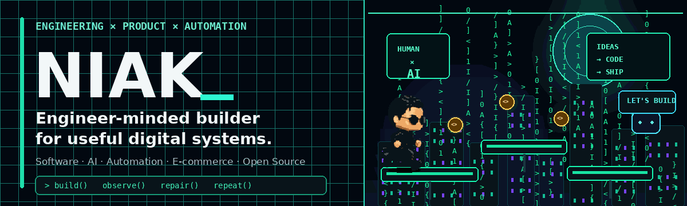
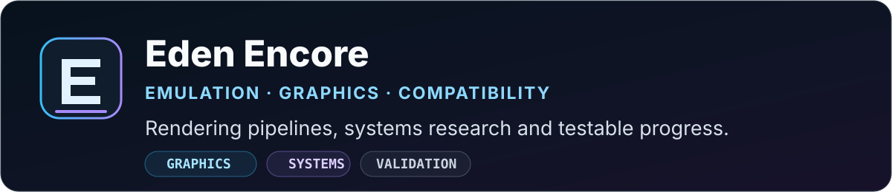
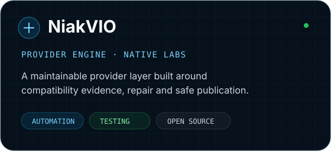
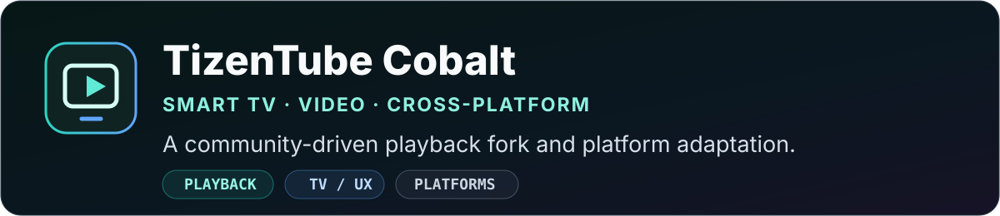
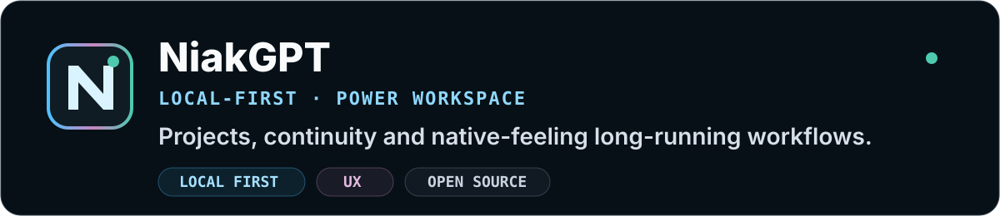
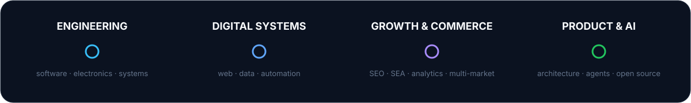
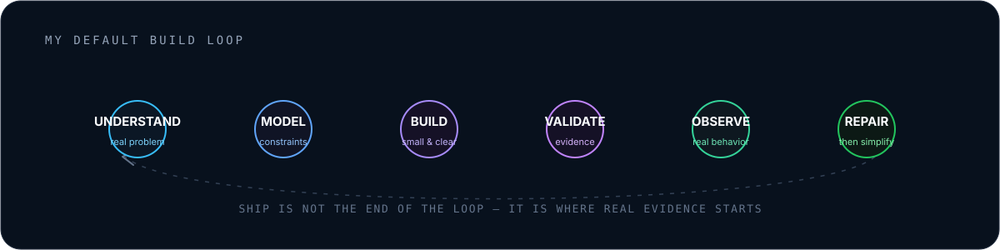

  

    

  

  <h2>Hey, I'm Niak.</h2>
  <strong>Software engineering · Product &amp; digital growth · AI &amp; automation</strong>
  
Building useful, maintainable software where systems, people and real-world constraints meet.

  <strong>English</strong> · <a href="README.fr.md">Français</a>
    

  <a href="#featured-projects">Projects</a> ·
  <a href="#background">Background</a> ·
  <a href="#how-i-work">Principles</a> ·
  <a href="#toolbox">Toolbox</a> ·
  <a href="#github-activity">Activity</a>

<!-- The PRO shield above is a custom README graphic, not GitHub's native profile subscription badge. -->

 

## What I'm building

I work across **software engineering, digital products and automation**. My background connects application development with more than a decade of web, e-commerce and growth work — including multi-market operations, marketplaces, analytics and conversion.

Today, I focus on **AI-assisted engineering, systems reliability, compatibility and practical automation**. I prefer observable progress, real tests and maintainable architecture over impressive-looking demos.

## Featured projects

**[Eden Encore](https://github.com/niakw/ProsperoEden-Encore)** — emulator engineering and compatibility research, with an emphasis on graphics pipelines, system integration, host-side validation and reproducible results. **Actively developed; compatibility remains a work in progress.**

**[NiakVIO](https://github.com/niakw/NiakVIO)** — a provider platform built around verifiable compatibility, structured diagnosis, repair workflows and native-device checks. [Project overview](https://projects.eittyweb.fr/en/niakvio/).

**[TizenTube Cobalt](https://github.com/niakw/TizenTubeCobalt)** — a community-driven media playback fork, with work on smart TV stability, viewing experience and platform adaptation. **Under active development.**

**[NiakGPT](https://github.com/niakw/NiakGPT)** — a local-first workspace exploring better continuity, navigation and ergonomics for complex, long-running ChatGPT projects. [Project overview](https://projects.eittyweb.fr/en/niakgpt/).

 

## Background

- **Engineering** — business applications, web platforms, systems integration, databases and automation.
- **Product & growth** — led digital marketing and e-commerce across **20+ web properties in four European markets**.
- **Delivery** — connecting architecture and implementation to people, performance, maintenance and measurable outcomes.

  

 

## How I work

Three rules stay visible in almost everything I build:

- **Understand the real problem before automating it.**
- **Prefer evidence over assumptions.**
- **Design for failure, observation and repair.**

<strong>The principles behind that</strong>

 

- Make the complex understandable.
- Automate repetition — not responsibility.
- Keep failure states visible instead of manufacturing green checks.
- Use AI to extend judgment, not hide it.
- Let architecture protect iteration rather than impress people.
- Ship → observe → repair → simplify → repeat.

 

  

 

## Toolbox

**Languages & core engineering**  
`JavaScript` · `TypeScript` · `PHP` · `Python` · `C++` · `C` · `SQL` · `HTML` · `CSS`

**Main application stack**  
`Node.js` · `React` · `Next.js` · `Symfony` · `REST APIs` · `Browser Extensions`

<strong>Full toolbox & domains</strong>

 

- **Programming & software engineering** — JavaScript, TypeScript, PHP, Python, C++, C, SQL, HTML, CSS, object-oriented programming, application architecture, business applications and technical problem solving.
- **Web & application stack** — Node.js, React, Next.js, Symfony, REST APIs, JSON, browser extensions, WebViews, third-party integrations and web application architecture.
- **Data & databases** — PostgreSQL, MySQL, SQLite, relational modelling, ETL, Talend, data transformation and database-backed application workflows.
- **Systems & infrastructure** — Linux/VPS, Docker, Docker Compose, Git, GitHub Actions, CI/CD, Cloudflare, Nginx/Caddy, systemd, reverse proxy/HTTPS, deployment workflows, health checks, logs, monitoring, backups and rollback thinking.
- **Testing & platform tooling** — Python test/validation scripts, CodeQL, Dependabot, Playwright/Chromium, Android emulator/ADB, native Android/TV testing, QEMU-based CI and cross-device compatibility work.
- **AI & automation** — AI-assisted workflows, agent orchestration, multi-provider routing, validation loops, local-first tooling, API automation, Zapier, workflow design and process automation.
- **E-commerce platforms** — PrestaShop, Shopify, WordPress, Webflow, catalogue operations, product data, marketplaces, modules/connectors, multi-store environments and e-commerce architecture.
- **SEO & acquisition** — technical SEO, content/search strategy, SEA, Google Ads, Meta Ads, TikTok Ads, marketplace acquisition and multi-market growth.
- **Analytics & performance** — Google Analytics, tracking plans, analytics instrumentation, Looker Studio, KPI dashboards, Excel, conversion analysis, UX/CRO and performance reporting.
- **CRM & lifecycle** — emailing, Mailchimp, Brevo/Sendinblue, Mailjet, automation scenarios and customer journey optimisation.
- **Product & delivery** — product architecture, digital strategy, project ownership, requirements, vendor coordination, cross-functional delivery, experimentation and continuous improvement.
- **Broader engineering exposure** — Android NDK/JNI, Java/Kotlin/Swift ecosystems, systems/networking fundamentals, cross-platform architecture, Tauri/WebViews and lower-level performance constraints.

 

## Current focus

`AI agents with validation` · `local-first software` · `cross-platform tooling` · `observability` · `e-commerce systems` · `product architecture`

 

## Find me

[GitHub projects](https://github.com/niakw?tab=repositories) · [Project portfolio](https://projects.eittyweb.fr/en/) · [French version](README.fr.md)

## GitHub activity

  <picture>
    <source media="(prefers-color-scheme: dark)" srcset="https://raw.githubusercontent.com/niakw/niakw/output/github-contribution-grid-snake-dark.svg" />
    <source media="(prefers-color-scheme: light)" srcset="https://raw.githubusercontent.com/niakw/niakw/output/github-contribution-grid-snake.svg" />
    
  </picture>

 

  

